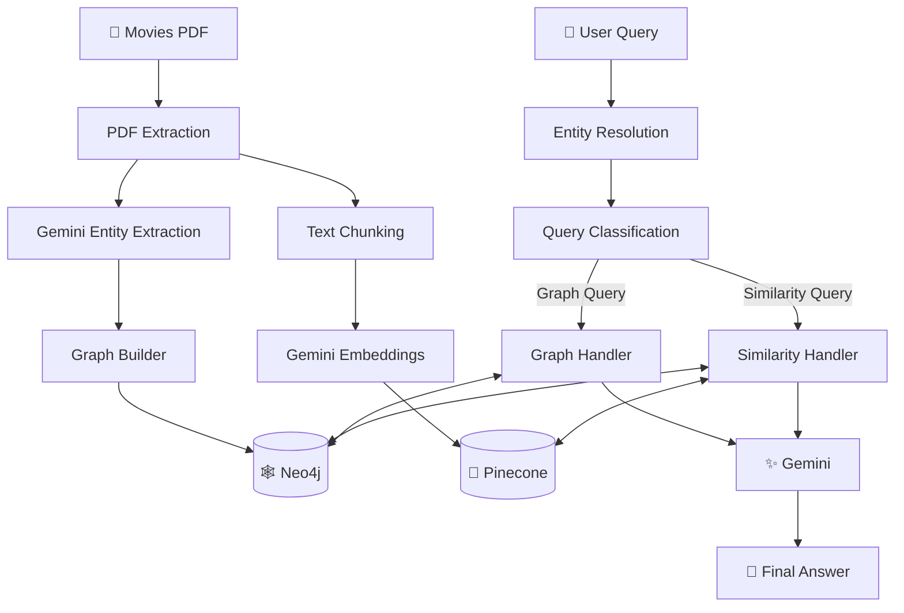
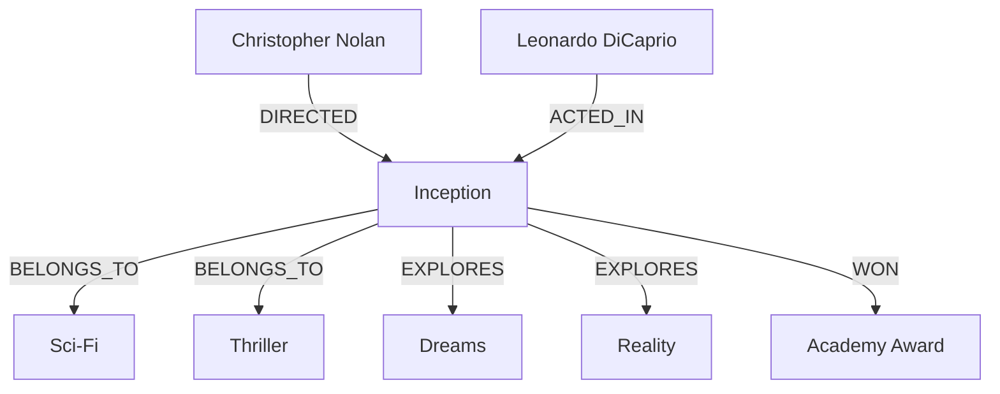

# 🎬 Movie GraphRAG — Complete Technical Notes

### 🧠 Zero-to-Hero Learning Guide | STRIKEGenAI Lectures 18 & 19

A practical deep dive into **Graph Retrieval-Augmented Generation (GraphRAG)** using JavaScript, Neo4j, Pinecone, and Google Gemini.

These notes explain the architecture, indexing pipeline, query workflow, knowledge graph, vector embeddings, entity resolution, safe Cypher generation, and hybrid retrieval approach used in the Movie GraphRAG project.

---

# 📚 Table of Contents

1. 🎯 Project Overview
2. 🧠 Understanding the Core Architecture
3. 🏗️ Complete System Architecture
4. 📁 Project File Structure
5. 🕸️ Neo4j Knowledge Graph Data Model
6. 🌲 Pinecone Vector Database
7. 📥 Indexing Pipeline — PDF to Knowledge
8. 🔍 Query Pipeline — Question to Answer
9. 🎯 Entity Resolution
10. 🧩 Query Classification
11. 🛡️ Safe Cypher Query Generation
12. 🔀 Graph Handler and Similarity Handler
13. 🎓 Lecture 18 — GraphRAG Fundamentals
14. 🚀 Lecture 19 — Improved GraphRAG Architecture
15. ⚖️ Lecture 18 vs Lecture 19
16. 💻 Practical Query Examples
17. 🛠️ Understanding Each Technology
18. 📝 Important Concepts & Key Takeaways
19. 🎤 Interview Preparation — Explaining the Project

---

# 1. 🎯 What Is Movie GraphRAG?

Movie GraphRAG is a practical implementation of **Graph Retrieval-Augmented Generation (GraphRAG)**.

The project takes unstructured movie information from a PDF and converts it into two searchable representations:

1. 🕸️ **Knowledge Graph** — Stores structured information and relationships using Neo4j.
2. 🌲 **Vector Index** — Stores semantic representations using Pinecone.

Google Gemini acts as the intelligence layer that extracts information, understands questions, classifies queries, plans retrieval, and generates answers.

### 🎯 What Problem Does It Solve?

A PDF contains information, but searching for complex relationships or finding semantically similar movies can be difficult.

For example, consider these questions:

- 🎬 Who directed Inception?
- 🎭 Which movies did Leonardo DiCaprio act in?
- 🏆 Which actors appeared in Oscar-winning movies?
- 🔍 Recommend movies similar to Inception.
- 🧠 Recommend mind-bending science-fiction thrillers.

Different questions require different retrieval strategies.

That's why this project combines graph databases and vector databases.

### 💡 The Most Important Mental Model

| Component | Responsibility |
|---|---|
| 🕸️ Neo4j | Facts, relationships, and graph traversal |
| 🌲 Pinecone | Semantic search and similarity |
| ✨ Gemini | Extraction, classification, planning, and answer generation |

**Remember:**

- Graph DB = Facts and relationships.
- Vector DB = Meaning and similarity.
- Gemini = Intelligence and orchestration.

---

# 2. 🧠 Understanding the Core Architecture

## 🕸️ A. Graph Database = Structured Knowledge

Neo4j stores information as nodes and relationships.

For example:

```text
Christopher Nolan
       |
       | DIRECTED
       |
       ▼
    Inception
       |
       | BELONGS_TO
       |
       ▼
    Sci-Fi
```

Neo4j is useful when a question requires exact relationships.

**Example questions:**

- Which movies did Christopher Nolan direct?
- Which actors worked in Oscar-winning movies?
- Which movies belong to the Sci-Fi genre?
- How are two movie-related entities connected?

## 🌲 B. Vector Database = Semantic Knowledge

Pinecone stores vector embeddings that represent the meaning of movie information.

An embedding is a numerical representation of text.

For example:

```text
"Inception is a science-fiction thriller
that explores dreams and reality."
                  |
                  ▼
          Embedding Model
                  |
                  ▼
       [0.12, 0.45, 0.89, ...]
                  |
                  ▼
              Pinecone
```

It is useful when a question requires semantic similarity rather than exact matching.

**Example questions:**

- Recommend movies similar to Inception.
- Find mind-bending thrillers.
- Recommend movies exploring dreams and reality.

## ✨ C. Gemini = Intelligence Layer

Gemini does not replace Neo4j or Pinecone.

It coordinates different operations:

- Extracting structured entities from PDFs.
- Classifying user queries.
- Creating structured query plans.
- Supporting retrieval decisions.
- Generating natural-language answers.

---

# 3. 🏗️ Complete System Architecture

The project has two major workflows:

1. 📥 Indexing Pipeline
2. 🔍 Query Pipeline



### 📥 Indexing

Builds the graph and vector database from the source PDF.

### 🔍 Querying

Understands the user's question and retrieves the relevant information.

### ✨ Answer Generation

Gemini converts retrieved information into a human-readable response.

---

# 4. 📁 Project File Structure

The project is organized into setup, indexing, and querying modules.

## 🗂️ Core Configuration

| File | Responsibility |
|---|---|
| `1_testConnection.js` | Tests service connections |
| `2_config.js` | Initializes Neo4j, Pinecone, Gemini, and shared helpers |

## 📥 Indexing Pipeline

| File | Responsibility |
|---|---|
| `3_pdfParser.js` | Extracts and chunks PDF text |
| `4_entityExtractor.js` | Extracts structured movie entities using Gemini |
| `5_graphBuilder.js` | Creates nodes and relationships in Neo4j |
| `6_vectorStore.js` | Generates embeddings and stores vectors |
| `7_runIndexing.js` | Orchestrates the complete indexing pipeline |

## 🔍 Query Pipeline

| File | Responsibility |
|---|---|
| `8_cypherTemplates.js` | Generates safe Cypher queries from structured plans |
| `9_entityResolver.js` | Resolves names against Neo4j |
| `10_queryClassifier.js` | Classifies queries |
| `11_graphHandler.js` | Handles factual, descriptive, and relationship queries |
| `12_similarityHandler.js` | Handles hybrid similarity and recommendation queries |
| `13_runQuery.js` | Starts the interactive query CLI |

## 📄 Other Files

- `data/movies.pdf` — Source movie dataset.
- `Notes.md` — Detailed project documentation.
- `README.md` — Project overview and setup guide.

---

# 5. 🕸️ Neo4j Knowledge Graph Data Model

Neo4j stores movie information through nodes and relationships.

## 📌 Node Types

| Node | Properties |
|---|---|
| `Movie` | title, year |
| `Director` | name |
| `Actor` | name |
| `Genre` | name |
| `Theme` | name |
| `Award` | name, category |

## 🔗 Relationship Types

| Relationship | Meaning |
|---|---|
| `DIRECTED` | Director → Movie |
| `ACTED_IN` | Actor → Movie |
| `BELONGS_TO` | Movie → Genre |
| `EXPLORES` | Movie → Theme |
| `WON` | Movie → Award |

### 🧩 Example Knowledge Graph



## 🚀 Why Use MERGE Instead of CREATE?

Neo4j supports two important operations:

**CREATE**

Creates a new node or relationship every time the operation executes.

**MERGE**

Matches an existing pattern or creates it if it does not exist.

Example:

```cypher
MERGE (a:Actor {name: "Leonardo DiCaprio"})
```

If the actor already exists, Neo4j reuses the existing node.

If the actor does not exist, Neo4j creates it.

### Why MERGE Matters

Without MERGE:

- Duplicate actor nodes can appear.
- Duplicate movie entities can be created.
- Graph relationships can become inconsistent.

With MERGE:

- Existing entities can be reused.
- Repeated indexing is safer.
- Graph consistency improves.

The graph builder also creates indexes to improve lookup and MERGE performance.

---

# 6. 🌲 Pinecone Vector Database

Pinecone stores movie embeddings for semantic retrieval.

## 🧠 What Is an Embedding?

An embedding converts text into a numerical vector representing its semantic meaning.

For example:

```text
Movie:
Inception

Description:
A science-fiction thriller exploring
dreams, reality, and identity.

              |
              ▼

       Gemini Embedding Model

              |
              ▼

[0.124, 0.452, 0.893, ...]
```

Movies with similar semantic content can have nearby vectors in the embedding space.

## 📄 What Information Is Embedded?

The project builds descriptive movie text using:

- Movie title
- Genre
- Release year
- Director
- Actors
- Themes
- Awards

### Example Embedding Text

> Inception is a Sci-Fi, Thriller movie released in 2010. Directed by Christopher Nolan. Starring Leonardo DiCaprio and Joseph Gordon-Levitt. The movie explores dreams, reality, and identity.

This text is converted into an embedding and stored in Pinecone.

## 📦 Pinecone Metadata

Along with embeddings, the project stores:

| Metadata | Purpose |
|---|---|
| `title` | Movie title |
| `year` | Release year |
| `director` | Director information |
| `actors` | Actor information |
| `genres` | Movie genres |
| `themes` | Movie themes |
| `text` | Original descriptive text |

### ⚙️ Vector Configuration

| Setting | Value |
|---|---|
| Embedding model | `gemini-embedding-001` |
| Vector dimension | `3072` |
| Vector database | Pinecone |

**Important:** The Pinecone index dimension must match the embedding dimension. Otherwise, vector upserts will fail.

---

# 7. 📥 Indexing Pipeline — PDF to Searchable Knowledge

The indexing pipeline transforms the source PDF into Neo4j graph data and Pinecone embeddings.

## Step 1️⃣: Start Indexing

Execute:

```bash
npm run index
```

The main orchestration file is:

`7_runIndexing.js`

It coordinates three major operations:

1. Entity extraction.
2. Knowledge graph construction.
3. Vector database construction.

## Step 2️⃣: Upload PDF to Gemini

File:

`4_entityExtractor.js`

The extractor uploads the PDF using Gemini Files API.

Why?

- Gemini can process the document directly.
- It avoids requiring a separate PDF parser for entity extraction.
- The uploaded file can be reused across extraction calls.

## Step 3️⃣: Extract Structured JSON

Gemini extracts structured movie information.

Example:

```json
{
  "movie": {
    "title": "Inception",
    "year": 2010
  },
  "director": {
    "name": "Christopher Nolan"
  },
  "actors": [
    "Leonardo DiCaprio",
    "Joseph Gordon-Levitt"
  ],
  "genres": [
    "Sci-Fi",
    "Thriller"
  ],
  "themes": [
    "Dreams",
    "Reality",
    "Identity"
  ],
  "awards": [
    "Academy Award"
  ]
}
```

Why is structured JSON important?

Because the graph builder requires predictable data.

If extraction is incorrect:

- Graph entities may be inaccurate.
- Relationships may be missing.
- Vector metadata may become noisy.

## Step 4️⃣: Build the Knowledge Graph

File:

`5_graphBuilder.js`

The extracted JSON is converted into:

- Movie nodes.
- Actor nodes.
- Director nodes.
- Genre nodes.
- Theme nodes.
- Award nodes.
- Relationships between these entities.

Neo4j now contains structured movie knowledge.

## Step 5️⃣: Build the Vector Store

File:

`6_vectorStore.js`

The vector pipeline:

1. Extracts text from the PDF.
2. Splits the text into chunks.
3. Generates embeddings using Gemini.
4. Stores vectors and metadata in Pinecone.

### 🎯 Final Result

Every movie can have two representations:

| Neo4j | Pinecone |
|---|---|
| Structured relationships | Semantic embeddings |
| Exact facts | Similarity |
| Graph traversal | Vector search |
| Entity connections | Meaning-based retrieval |

This is the foundation of GraphRAG.

---

# 8. 🔍 Query Pipeline — Question to Answer

The query pipeline starts through:

```bash
npm run query
```

Main entry point:

`13_runQuery.js`

The Lecture 19 workflow follows this sequence:

```text
User Question
     |
     ▼
Entity Resolution
     |
     ▼
Query Classification
     |
     ▼
Choose Handler
     |
     ├── Graph Handler
     |
     └── Similarity Handler
              |
              ▼
       Retrieve Information
              |
              ▼
          Gemini
              |
              ▼
         Final Answer
```

The key improvement is that entity resolution happens before classification.

---

# 9. 🎯 Entity Resolution

File:

`9_entityResolver.js`

Entity resolution identifies names mentioned in the user's question and maps them to actual entities in the Neo4j knowledge graph.

## 🤔 Why Is Entity Resolution Needed?

Users do not always provide complete entity names.

For example:

- Nolan instead of Christopher Nolan.
- DiCaprio instead of Leonardo DiCaprio.
- Inception instead of the full movie description.

The system needs to understand what those names represent.

## ⚙️ How It Works

1. Gemini extracts names from the user query.
2. The extracted names are searched against Neo4j node types.
3. The system identifies matching entities and their labels.
4. Resolved information is passed to the query classifier.

### Example

User query:

```text
Show me Nolan movies.
```

Entity resolution:

```text
Mention: Nolan

Resolved Entity:
Label: Director
Name: Christopher Nolan
```

Another example:

```text
Mention: DiCaprio

Resolved Entity:
Label: Actor
Name: Leonardo DiCaprio
```

### 🚀 Why Is This Important?

It gives the classifier additional context.

Instead of classifying an ambiguous name, the system can classify the question using an already resolved entity.

**Lecture 19's major improvement is entity grounding before query routing.**

---

# 10. 🧩 Query Classification

File:

`10_queryClassifier.js`

After entity resolution, Gemini determines the type of query.

The updated architecture uses two primary categories:

| Category | Purpose |
|---|---|
| `graph` | Factual, descriptive, and relationship-based questions |
| `similarity` | Semantic similarity and recommendations |

### Examples

| User Query | Classification |
|---|---|
| Movies directed by Nolan | Graph |
| How is DiCaprio related to Nolan? | Graph |
| Tell me about Inception | Graph |
| Movies similar to Inception | Similarity |

### 🧠 Why Classification Matters

Not every question should be sent to the same database.

For example:

- "Who directed Inception?" requires an exact relationship.
- "Recommend movies like Inception" requires semantic similarity.

Classification helps the system choose the appropriate retrieval strategy.

---

# 11. 🛡️ Safe Cypher Query Generation

File:

`8_cypherTemplates.js`

A major challenge in GraphRAG is converting natural language into database queries.

For example:

```text
Find actors who appeared in Oscar-winning sci-fi movies.
```

This requires multiple graph traversals and filters.

## ❌ Why Not Directly Generate Cypher?

Allowing an LLM to generate arbitrary Cypher and execute it directly can introduce:

- Destructive database operations.
- Invalid query structures.
- Unsupported relationships.
- Incorrect property references.
- Unpredictable query behavior.

## ✅ The Solution: Structured Query Planning

Gemini first converts the user's question into a structured JSON plan.

Example:

```json
{
  "steps": [
    {
      "type": "traversal",
      "from": "Actor",
      "rel": "ACTED_IN",
      "to": "Movie"
    },
    {
      "type": "traversal",
      "from": "Movie",
      "rel": "WON",
      "to": "Award"
    },
    {
      "type": "traversal",
      "from": "Movie",
      "rel": "BELONGS_TO",
      "to": "Genre"
    },
    {
      "type": "filter",
      "field": "Award.name",
      "op": "=",
      "value": "Oscar"
    },
    {
      "type": "filter",
      "field": "Genre.name",
      "op": "=",
      "value": "Sci-Fi"
    },
    {
      "type": "projection",
      "fields": [
        "Actor.name"
      ],
      "distinct": true
    }
  ]
}
```

The template system converts the validated plan into Cypher.

## 🔐 What Does the Template Layer Control?

- Allowed node labels.
- Allowed relationship types.
- Allowed properties.
- Allowed operators.
- Query structure.

### 💡 Important Architecture Pattern

```text
User Question
      |
      ▼
     Gemini
      |
      ▼
Structured Query Plan
      |
      ▼
Validation & Templates
      |
      ▼
     Cypher
      |
      ▼
     Neo4j
```

**Remember:**

LLM = Understanding

Templates = Control

Neo4j = Execution

This separation improves reliability and reduces the risk of arbitrary query execution.

---

# 12. 🔀 Graph Handler & Similarity Handler

Lecture 19 uses two primary handlers.

## 🕸️ A. Graph Handler

File:

`11_graphHandler.js`

Handles three graph query styles:

### 1. Factual Queries

Example:

```text
Who directed Inception?
```

Uses graph traversal to retrieve exact information.

### 2. Descriptive Queries

Example:

```text
Tell me about Inception.
```

Uses the resolved entity and its graph information to construct a description.

### 3. Relationship Queries

Example:

```text
How is Christopher Nolan connected to Leonardo DiCaprio?
```

Uses graph paths to identify relationships between entities.

### Graph Handler Workflow

```text
User Query
    |
    ▼
Entity Resolution
    |
    ▼
Gemini Planning
    |
    ▼
Safe Cypher Templates
    |
    ▼
Neo4j Execution
    |
    ▼
Gemini Answer Generation
```

## 🌲 B. Similarity Handler

File:

`12_similarityHandler.js`

Handles semantic similarity and movie recommendations.

It combines three components:

1. Pinecone vector search.
2. Neo4j genre and theme filtering.
3. Gemini ranking and explanation.

### Example

User query:

```text
Recommend movies similar to Inception.
```

Workflow:

```text
User Query
    |
    ▼
Resolve Inception
    |
    ▼
Generate Query Embedding
    |
    ▼
Pinecone Vector Search
    |
    ▼
Candidate Movies
    |
    ▼
Neo4j Genre / Theme Filtering
    |
    ▼
Gemini Ranking
    |
    ▼
Final Recommendations
```

### Why Hybrid Retrieval?

Pinecone finds semantically similar candidates.

Neo4j provides structured information that can help evaluate those candidates.

Gemini ranks and explains the recommendations.

**This is more informative than relying only on vector similarity.**

---

# 13. 🎓 Lecture 18 — GraphRAG Fundamentals

Lecture 18 introduces the baseline GraphRAG architecture.

### Main Concepts

- Extract structured data from PDF documents.
- Store facts in Neo4j.
- Store semantic representations in Pinecone.
- Use Gemini for extraction and query classification.
- Retrieve information from the appropriate database.
- Generate natural-language answers.

### Architecture

```text
PDF
 |
 ▼
Gemini Extraction
 |
 ├── Neo4j Graph
 |
 └── Pinecone Vectors

User Query
 |
 ▼
Query Classification
 |
 ├── Graph Retrieval
 |
 ├── Similarity Retrieval
 |
 └── Descriptive Retrieval
         |
         ▼
       Gemini
         |
         ▼
     Final Answer
```

### Strengths

- Clear separation of graph and vector retrieval.
- Supports factual and similarity questions.
- Uses structured query generation.
- Combines databases with an LLM.

### Limitation

The original approach classifies queries before deeper entity grounding.

This can make ambiguous entity names more difficult to interpret.

---

# 14. 🚀 Lecture 19 — Improved GraphRAG Architecture

Lecture 19 improves the baseline architecture by introducing entity resolution before classification.

### Major Improvements

1. 🎯 Entity resolution happens first.
2. 🧠 Classification uses resolved entity context.
3. 🕸️ Graph queries are handled by one unified handler.
4. 🌲 Similarity retrieval combines Pinecone and Neo4j.
5. 🛡️ Structured query planning continues to control graph execution.

### Why Is Entity Resolution Important?

Consider:

```text
Show me Nolan movies.
```

Without entity resolution, "Nolan" is simply a name mentioned in a question.

With entity resolution:

```text
Nolan
  |
  ▼
Christopher Nolan
  |
  ▼
Label: Director
```

The system now has more context to understand the query.

### Unified Graph Handling

Instead of maintaining separate graph handlers for different graph question styles, Lecture 19 uses:

`11_graphHandler.js`

It supports:

- Factual traversal.
- Entity descriptions.
- Relationship paths.

### Hybrid Similarity Handling

`12_similarityHandler.js` combines:

- Vector similarity from Pinecone.
- Genre and theme information from Neo4j.
- Gemini ranking and explanation.

---

# 15. ⚖️ Lecture 18 vs Lecture 19

## 🔍 Main Difference

<mark>Lecture 18: Route first, then answer.</mark>

<mark>Lecture 19: Resolve first, then route, then answer.</mark>

| Feature | Lecture 18 | Lecture 19 |
|---|---|---|
| Entity Resolution | Not performed as the initial grounding stage | Performed before classification |
| Classification | Based primarily on query intent | Uses resolved entity context |
| Graph Handling | Multiple query paths | Unified graph handler |
| Similarity | Vector-based retrieval | Hybrid vector + graph retrieval |
| Descriptive Queries | Separate descriptive routing | Included in graph handling |
| Relationship Queries | Graph retrieval | Unified graph handling with path queries |
| Architecture | Baseline GraphRAG | Improved and grounded GraphRAG |

### 🏆 Why Is Lecture 19 Better?

Lecture 19 improves the retrieval workflow because it understands the entities before choosing the retrieval path.

This provides:

- Better interpretation of ambiguous names.
- More grounded query classification.
- Cleaner graph query handling.
- Hybrid recommendations.
- Better separation between understanding, planning, and execution.

### Easy Way to Remember

**Lecture 18**

```text
Question → Classification → Retrieval → Answer
```

**Lecture 19**

```text
Question → Entity Resolution → Classification
         → Retrieval → Answer
```

---

# 16. 💻 Practical Query Examples

## Example 1️⃣: Movies Directed by Christopher Nolan

User:

```text
Which movies were directed by Christopher Nolan?
```

Workflow:

1. Entity resolution identifies Christopher Nolan as a Director.
2. Query classifier selects `graph`.
3. Gemini creates a traversal plan.
4. Cypher templates generate a safe query.
5. Neo4j retrieves matching movies.
6. Gemini generates the final answer.

Why Neo4j?

Because the question depends on the exact `DIRECTED` relationship.

## Example 2️⃣: Movies Similar to Inception

User:

```text
Recommend movies similar to Inception.
```

Workflow:

1. Entity resolution identifies Inception.
2. Query classifier selects `similarity`.
3. The query is converted into an embedding.
4. Pinecone retrieves similar movies.
5. Neo4j provides genre and theme information.
6. Gemini ranks and explains recommendations.

Why Pinecone?

Because the question is about semantic similarity rather than an exact relationship.

## Example 3️⃣: Tell Me About James Cameron

User:

```text
Tell me about James Cameron.
```

Workflow:

1. Entity resolution identifies James Cameron.
2. Query classifier selects the graph path.
3. Graph Handler retrieves associated information.
4. Gemini generates a descriptive response.

Why GraphRAG?

Because the answer can use structured relationships between the director and movies.

## Example 4️⃣: Actors in Oscar-Winning Sci-Fi Movies

User:

```text
Find actors who appeared in Oscar-winning sci-fi movies.
```

Workflow:

1. Query classification selects `graph`.
2. Gemini creates a structured plan.
3. The plan contains actor, movie, award, and genre traversals.
4. Safe Cypher is generated.
5. Neo4j retrieves the actors.
6. Gemini formats the response.

Why Neo4j?

Because the answer depends on multiple connected relationships.

---

# 17. 🛠️ Understanding Each Technology

## 🕸️ Neo4j

A graph database that stores data as nodes, relationships, and properties.

Useful for:

- Relationship traversal.
- Connected entity discovery.
- Multi-hop queries.
- Structured filtering.

## 🌲 Pinecone

A vector database designed for similarity search.

Useful for:

- Semantic search.
- Recommendation systems.
- Vector storage.
- Metadata filtering.

## ✨ Google Gemini

A family of generative AI models.

In this project, Gemini supports:

- PDF entity extraction.
- Query classification.
- Structured query planning.
- Embedding generation.
- Answer generation.

## 🔢 Embeddings

Numerical representations of text that capture semantic information.

Similar meanings can be represented by nearby vectors.

## 🧩 Cypher

Cypher is Neo4j's declarative query language.

Example:

```cypher
MATCH (d:Director {name: "Christopher Nolan"})
      -[:DIRECTED]->(m:Movie)
RETURN m.title, m.year;
```

This query finds movies directed by Christopher Nolan.

---

# 18. 📝 Important Concepts & Key Takeaways

## 🧠 Core Concepts

| Concept | Meaning |
|---|---|
| GraphRAG | Combines graph retrieval with generative AI |
| Knowledge Graph | Entities connected through relationships |
| Node | An entity in a graph |
| Relationship | A connection between graph entities |
| Embedding | Numerical representation of semantic meaning |
| Vector Search | Finds semantically similar vectors |
| Entity Resolution | Maps mentioned names to known entities |
| Query Classification | Determines the query retrieval category |
| Cypher | Neo4j query language |
| Hybrid Retrieval | Combines vector and structured graph retrieval |
| Query Planning | Converts natural-language intent into structured operations |

## 🎯 Six Things You Must Remember

1. 🕸️ **Neo4j handles facts and relationships.**
2. 🌲 **Pinecone handles meaning and similarity.**
3. ✨ **Gemini handles intelligence and orchestration.**
4. 📥 **Indexing builds both representations from the same source.**
5. 🔍 **Query routing selects the appropriate retrieval strategy.**
6. 🎯 **Lecture 19 introduces entity resolution before classification.**

### 🔥 Complete Project in Eight Steps

```text
1. Read the PDF.
       |
2. Extract structured movie entities.
       |
3. Store facts in Neo4j.
       |
4. Generate embeddings.
       |
5. Store vectors in Pinecone.
       |
6. Accept the user's question.
       |
7. Resolve entities and classify the query.
       |
8. Retrieve information and generate an answer.
```

---

# 19. 🎤 Interview Preparation — Explain Your Project

### Q1. What is GraphRAG?

GraphRAG is an approach that combines knowledge graph retrieval with generative AI. It uses structured relationships and semantic retrieval to provide relevant context for answering questions.

### Q2. Why did you use Neo4j and Pinecone together?

Neo4j handles structured relationships and factual queries, whereas Pinecone handles semantic similarity and recommendations. Combining them supports both exact and meaning-based retrieval.

### Q3. What is the role of Gemini?

Gemini performs entity extraction, query classification, structured query planning, embedding generation, and natural-language answer generation.

### Q4. What is entity resolution?

Entity resolution identifies names mentioned in a user query and maps them to actual entities in the knowledge graph.

For example, it resolves "Nolan" to "Christopher Nolan" and identifies the entity as a Director.

### Q5. Why not use only a vector database?

Vector databases are good at semantic similarity, but they are not designed to represent explicit relationships and multi-hop graph traversal as naturally as graph databases.

### Q6. Why do you use Cypher templates?

They constrain generated queries to supported labels, relationships, properties, and operators instead of executing arbitrary LLM-generated Cypher.

### Q7. What is hybrid retrieval?

Hybrid retrieval combines semantic vector search with structured graph information to improve the relevance of retrieved results.

### Q8. What is the difference between Lecture 18 and Lecture 19?

Lecture 18 uses the baseline GraphRAG retrieval workflow. Lecture 19 improves it by adding entity resolution before classification, unifying graph handling, and introducing hybrid similarity retrieval.

---

# 🏁 Final Project Summary

Movie GraphRAG demonstrates how multiple technologies can work together to build an intelligent retrieval and recommendation system.

The architecture combines:

- 🕸️ **Neo4j** — Knowledge Graph
- 🌲 **Pinecone** — Vector Database
- ✨ **Google Gemini** — LLM and Embedding Model
- 🟨 **JavaScript / Node.js** — Application Runtime

The most important architectural idea is:

> A practical GraphRAG system where Neo4j handles facts, Pinecone handles semantic similarity, and Gemini coordinates extraction, query understanding, retrieval planning, and natural-language answers.

---

<div align="center">

## 🚀 Learn. Build. Understand. Innovate.

**🎬 Movie GraphRAG | STRIKEGenAI — Lectures 18 & 19**

*Connecting Movies Through Knowledge Graphs and Semantic Intelligence.*

</div>