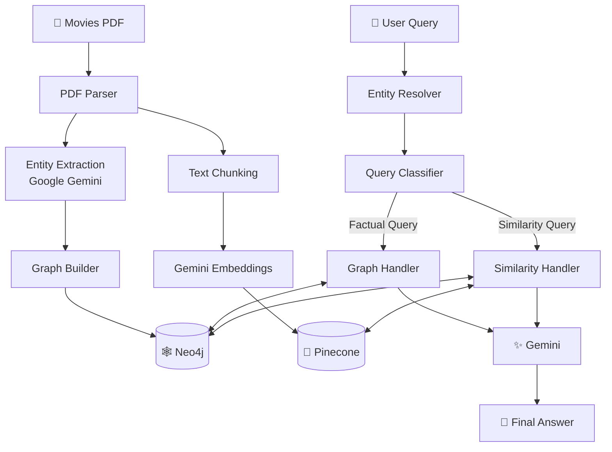

# 🎬 Movie GraphRAG

### 🧠 Intelligent Movie Knowledge Graph & Semantic Recommendation System

Movie GraphRAG is a **JavaScript-based GraphRAG (Graph Retrieval-Augmented Generation) project** that transforms movie-related PDF documents into a searchable knowledge graph and vector database.

It combines **Graph Database + Vector Search + Generative AI** to answer factual questions, explore relationships between movie entities, and generate context-aware movie recommendations.

---

## 🚀 Tech Stack

| Technology | Purpose |
|---|---|
| 🟢 **Neo4j** | Stores structured movie facts and entity relationships |
| 🌲 **Pinecone** | Vector database for semantic search and recommendations |
| ✨ **Google Gemini** | Entity extraction, query classification, embeddings, and answer generation |
| 🟨 **Node.js** | JavaScript runtime for the entire pipeline |
| 📄 **PDF Parser** | Extracts movie information from PDF documents |

---

## ⚙️ How It Works

Movie GraphRAG consists of two major pipelines:

### 1️⃣ 📥 Indexing Pipeline

The indexing pipeline processes `data/movies.pdf` and transforms unstructured movie information into structured graph data and vector embeddings.

**Workflow:**

1. 📄 **PDF Extraction** – Extracts and chunks text from the source PDF.
2. 🤖 **Entity Extraction** – Uses Gemini to identify movies, actors, directors, genres, themes, and awards.
3. 🕸️ **Graph Construction** – Stores entities and their relationships in Neo4j.
4. 🧩 **Text Embedding** – Generates vector embeddings using Gemini.
5. ☁️ **Vector Storage** – Stores embeddings and associated metadata in Pinecone.

### 2️⃣ 🔍 Query & Retrieval Pipeline

The interactive query pipeline intelligently determines how to retrieve information based on the user's question.

**Workflow:**

1. 🎯 **Entity Resolution** – Resolves movie names and other entities against Neo4j.
2. 🧠 **Query Classification** – Determines whether the question requires graph-based retrieval or semantic similarity search.
3. 🕸️ **Graph Retrieval** – Uses Neo4j for factual questions and relationship-based queries.
4. 🔎 **Vector Retrieval** – Uses Pinecone for semantic similarity and movie recommendations, with Neo4j providing additional structured context.
5. ✨ **Answer Generation** – Uses Gemini to generate the final context-aware response.

---

## 🏗️ System Architecture



---

## 📋 Prerequisites

Make sure you have the following installed or configured:

- 🟢 **Node.js** 18 or newer
- 🕸️ **Neo4j Database** (Neo4j Aura or local instance)
- 🌲 **Pinecone Account** with an initialized index
- ✨ **Google AI Studio API Key** with Gemini access
- 📄 Source PDF available at `data/movies.pdf`

---

## 🛠️ Installation & Setup

### Step 1: Clone the Repository

```bash
git clone <your-repository-url>
cd <project-folder>
```

### Step 2: Install Dependencies

```bash
npm install
```

### Step 3: Configure Environment Variables

Create a `.env` file in the project root directory:

```env
# 🕸️ Neo4j Configuration
NEO4J_URI=neo4j+s://your-instance.databases.neo4j.io
NEO4J_USERNAME=neo4j
NEO4J_PASSWORD=your-neo4j-password
NEO4J_DATABASE=neo4j

# 🌲 Pinecone Configuration
PINECONE_API_KEY=your-pinecone-api-key
PINECONE_INDEX_NAME=your-pinecone-index

# ✨ Google Gemini Configuration
GEMINI_API_KEY=your-gemini-api-key
```

> ⚠️ **Important:** Never commit your `.env` file or expose your API keys publicly.

### Step 4: Configure Pinecone Index

Create a Pinecone index with the following configuration:

| Configuration | Value |
|---|---|
| Embedding Model | `gemini-embedding-001` |
| Vector Dimension | `3072` |
| Index Name | Your configured index name |

**Note:** The Pinecone index must support **3072-dimensional vectors** because this project uses Gemini's `gemini-embedding-001` embedding model.

### Step 5: Add the Source PDF

Place your movie dataset inside the `data` directory:

```text
data/
└── movies.pdf
```

---

## ▶️ Running the Project

### 🧪 1. Test Service Connections

Verify the connections to Neo4j, Pinecone, Gemini, and the embedding service.

```bash
npm test
```

### 📥 2. Run the Indexing Pipeline

Build the movie knowledge graph and populate the Pinecone vector store.

```bash
npm run index
```

### 💬 3. Start the Interactive Query CLI

Launch the interactive question-answering interface.

```bash
npm run query
```

Type your questions in the terminal. Enter `exit` to stop the application.

---

## 💡 Example Queries

Once indexing is complete, try asking questions like:

| Query Type | Example Question |
|---|---|
| 🎬 Movie Facts | Who directed Inception? |
| 🎭 Actor Relationships | Which movies did Leonardo DiCaprio act in? |
| 🔍 Recommendations | Recommend movies similar to Inception. |
| 🏆 Award Exploration | Which sci-fi movies won awards? |
| 🧠 Semantic Search | Find movies exploring similar themes. |

---

## 📁 Project Structure

```text
Movie-GraphRAG/
│
├── 📂 data/
│   └── 📄 movies.pdf
│
├── 1_testConnection.js
├── 2_config.js
├── 3_pdfParser.js
├── 4_entityExtractor.js
├── 5_graphBuilder.js
├── 6_vectorStore.js
├── 7_runIndexing.js
├── 8_cypherTemplates.js
├── 9_entityResolver.js
├── 10_queryClassifier.js
├── 11_graphHandler.js
├── 12_similarityHandler.js
├── 13_runQuery.js
│
├── 📄 Notes.md
├── 📄 package.json
├── 📄 package-lock.json
├── 🔐 .env
└── 📄 README.md
```

### 📌 File Responsibilities

| File | Description |
|---|---|
| `1_testConnection.js` | Tests Neo4j, Pinecone, Gemini, and embedding connections |
| `2_config.js` | Initializes shared service clients and embedding helpers |
| `3_pdfParser.js` | Extracts and chunks text from the source PDF |
| `4_entityExtractor.js` | Extracts structured movie entities using Gemini |
| `5_graphBuilder.js` | Creates movie entities and relationships in Neo4j |
| `6_vectorStore.js` | Generates embeddings and upserts vectors into Pinecone |
| `7_runIndexing.js` | Executes the complete indexing pipeline |
| `8_cypherTemplates.js` | Provides safe Cypher query templates |
| `9_entityResolver.js` | Resolves user query entities against Neo4j |
| `10_queryClassifier.js` | Classifies queries for graph or similarity retrieval |
| `11_graphHandler.js` | Handles factual and relationship-based queries |
| `12_similarityHandler.js` | Handles similarity searches and recommendations |
| `13_runQuery.js` | Runs the interactive query CLI |
| `Notes.md` | Contains detailed GraphRAG explanations and implementation notes |

---

## 🕸️ Knowledge Graph Data Model

Neo4j represents movie information through interconnected nodes and relationships.

### 📌 Node Labels

- 🎬 `Movie`
- 🎥 `Director`
- 🎭 `Actor`
- 🎨 `Genre`
- 💭 `Theme`
- 🏆 `Award`

### 🔗 Relationships

| Relationship | Description |
|---|---|
| `DIRECTED` | Connects a director to a movie |
| `ACTED_IN` | Connects an actor to a movie |
| `BELONGS_TO` | Connects a movie to its genre |
| `EXPLORES` | Connects a movie to its themes |
| `WON` | Connects a movie to an award |

### 🌲 Pinecone Vector Metadata

Along with movie embeddings, Pinecone stores useful metadata such as:

- Movie title
- Release year
- Director
- Actors
- Genres
- Themes
- Source text

This allows the system to combine semantic similarity with structured movie information.

---

## 🧠 Why GraphRAG?

Traditional RAG primarily relies on retrieving semantically similar text chunks. GraphRAG extends this approach by incorporating structured relationships between entities.

| Traditional RAG | GraphRAG |
|---|---|
| Primarily retrieves text chunks | Retrieves graph relationships and vector matches |
| Focuses on semantic similarity | Combines semantic and relational understanding |
| Limited explicit relationship traversal | Supports multi-entity relationship exploration |
| Context from retrieved documents | Context from documents, graphs, and vectors |

**Movie GraphRAG combines both approaches** to provide more meaningful answers to movie-related questions.

---

## 📝 Important Notes

- ✅ Run `npm test` before indexing for the first time.
- 🔄 Re-running the indexer is designed to be safe because the graph builder uses Neo4j's `MERGE` operations for graph entities.
- 🔐 Keep `.env` private and ensure it is excluded through `.gitignore`.
- 📄 Make sure `data/movies.pdf` exists before running the indexing pipeline.
- 🌲 Ensure your Pinecone index has the correct vector dimension (`3072`).
- 📚 Refer to `Notes.md` for the detailed GraphRAG explanation and implementation walkthrough.

---

## 🎯 Project Goal

The goal of Movie GraphRAG is to explore how **Knowledge Graphs, Vector Databases, and Large Language Models** can work together to build intelligent retrieval and recommendation systems.

It demonstrates a practical implementation of combining structured knowledge retrieval with semantic search and generative AI.

---

<div align="center">

### 🚀 Built with ❤️ using JavaScript, Neo4j, Pinecone & Google Gemini

**🎬 Movie GraphRAG — Connecting Movies Through Knowledge & Intelligence**

</div>